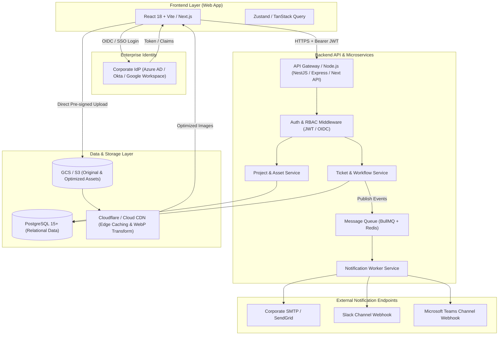

# INET UX/UI Gallery - Developer Specification & Architecture Guide

เอกสารคู่มือสถาปัตยกรรมทางเทคนิคและการเตรียมพัฒนา (Technical Specification) สำหรับทีม **Software Engineering & Backend Developers** ในการสร้างระบบ **INET UX/UI Gallery**

---

## 🏛️ High-Level System Architecture



---

## 1. Authentication: Enterprise SSO & RBAC

### 1.1 โปรโตคอลและการเชื่อมต่อ (OIDC / OAuth 2.0 with PKCE)
- **Identity Provider (IdP):** รองรับ **Microsoft Entra ID (Azure AD)**, **Okta**, หรือ **Google Workspace (INET Google Org)**
- **Libraries แนะนำ:** `next-auth` / `@auth/core`, `passport-azure-ad`, หรือ `openid-client`
- **Session Management:** Secure HTTP-only SameSite Cookie หรือ Encrypted JWT (RS256) ที่มีอายุ 8–12 ชั่วโมง พร้อม Silent Token Refresh

### 1.2 สิทธิ์การใช้งานและการควบคุม (Role-Based Access Control - RBAC)

| Role | สิทธิ์การเข้าถึง (Permissions) | ตัวอย่างกลุ่มผู้ใช้ |
| :--- | :--- | :--- |
| **`SUPER_ADMIN`** | จัดการ User Roles, ตั้งค่าระบบ, ลบ Project, จัดการตั๋วทุกใบ | Head of UX/UI, System Admin |
| **`DESIGNER`** | สร้าง/แก้ไข/Publish โปรเจกต์, อัปเดต Design Tokens, รับ Ticket และเปลี่ยนสถานะ | สมาชิกทีม UX/UI Design |
| **`DEVELOPER`** | ดู Project, Inspect Design Tokens, ดาวน์โหลด Asset, ยื่น Request Ticket | ทีม Software Engineer, QA, Product Owner |
| **`VIEWER`** | อ่านข้อมูลโปรเจกต์ที่เผยแพร่แล้ว (Published เท่านั้น) | พนักงานทั่วไปในองค์กร |

### 1.3 JWT Payload Example
```json
{
  "sub": "a4d3f23a-5310-4820-91bc-3e9a59b6c102",
  "email": "paworn.k@inet.co.th",
  "name": "Paworn Keeratiparadorn",
  "role": "DESIGNER",
  "department": "UX/UI Design Center",
  "iat": 1793174400,
  "exp": 1793217600
}
```

---

## 2. Database Schema: PostgreSQL & ORM

โครงสร้างฐานข้อมูลแบบสมบูรณ์พร้อม DDL Script ได้จัดเตรียมไว้ที่ไฟล์ [`schema.sql`](file:///Users/glamouract/Desktop/GB%20งาน/2026%20UXUI%20Gallery/schema.sql) และ Prisma Schema ที่ [`prisma/schema.prisma`](file:///Users/glamouract/Desktop/GB%20งาน/2026%20UXUI%20Gallery/prisma/schema.prisma)

### ตารางหลักทั้ง 4 ตาราง:
1. **`users`**: จัดเก็บข้อมูลผู้ใช้งานจาก SSO, Role, แผนก, และสถานะการใช้งาน
2. **`projects`**: ข้อมูลโปรเจกต์ Showcase, Figma URL, Design Context, Do's & Don'ts, Screens (JSONB) และ Design Tokens (JSONB) รองรับ Full-text / GIN Index
3. **`requests`**: ตั๋วคำขอออกแบบ (Ticket System) พร้อมเลขรันอัตโนมัติ `REQ-YYYY-XXXX`, Requester ID, Assigned Designer, Priority, Due Date และ Status
4. **`comments_logs`**: บันทึก Activity Log ทุกครั้งที่มีการเปลี่ยนแปลงสถานะ, การมอบหมายงาน หรือการแสดงความคิดเห็น

---

## 3. Asset Storage: Cloud Storage & Image Optimization

### 3.1 สถาปัตยกรรมการอัปโหลดรูปภาพ (Direct Pre-Signed URL)
เพื่อป้องกันปัญหา Backend คอขวดจากการรับไฟล์ขนาดใหญ่ ให้ใช้ Flow แบบ **Direct Client-to-Storage Upload**:
1. Frontend ส่ง Request ขอ Pre-signed URL: `POST /api/assets/presigned-url`
2. Backend ตรวจสอบสิทธิ์ (ต้องเป็น Role `DESIGNER` หรือ `SUPER_ADMIN`) และสร้าง Pre-signed URL ของ GCS/S3 โดยจำกัด Content-Type (image/png, image/jpeg, image/webp) และขนาดไฟล์ไม่เกิน 15MB
3. Frontend ทำการ `PUT` ไฟล์ภาพขึ้น Cloud Storage Bucket โดยตรง
4. Frontend บันทึก URL ที่เสร็จสมบูรณ์กลับมาที่ API เพื่อผูกกับ Project

### 3.2 โครงสร้าง Bucket & Paths
```text
inet-uxui-assets-prod/
├── projects/
│   └── {project_slug}/
│       ├── cover.png
│       └── screens/
│           ├── register-{timestamp}.png
│           ├── dashboard-{timestamp}.png
│           └── landing-{timestamp}.png
└── requests/
    └── {ticket_id}/
        └── attachments/{filename}
```

### 3.3 Image Optimization & CDN Delivery
- **CDN:** เชื่อมต่อผ่าน **Cloudflare** หรือ **Google Cloud CDN**
- **Dynamic Resizing & Next-Gen Formats:**
  - แปลงเป็น `.webp` หรือ `.avif` อัตโนมัติที่ Edge
  - รองรับ Dynamic Query Params เช่น:
    - Thumbnail: `https://cdn.gallery.inet.co.th/projects/harvesta/cover.png?width=400&format=webp`
    - Hero High-Res: `https://cdn.gallery.inet.co.th/projects/harvesta/cover.png?width=1200&format=webp`
- **Cache Header Standard:**
  ```http
  Cache-Control: public, max-age=31536000, immutable
  ```

---

## 4. Notification Engine: Email & Webhook

ใช้รูปแบบ **Event-Driven Architecture** โดยส่งข้อความเข้า Queue (เช่น **Redis + BullMQ** หรือ **Google Cloud Tasks**) เพื่อไม่ให้กระทบ Performance ของ API หลัก

### 4.1 เหตุการณ์ที่ต้องแจ้งเตือน (Events Trigger)
- `ticket.created`: แจ้งเตือน Lead Designer เมื่อมีคำขอใหม่
- `ticket.assigned`: แจ้งเตือน Designer ที่ได้รับมอบหมาย
- `ticket.status_changed`: แจ้งเตือน Requester เมื่อสถานะเปลี่ยน (เช่น In Progress, Review Ready, Completed)
- `ticket.commented`: แจ้งเตือนทั้งสองฝ่ายเมื่อมีความคิดเห็นใหม่

### 4.2 Microsoft Teams Webhook (Adaptive Card Payload)
```json
{
  "type": "message",
  "attachments": [
    {
      "contentType": "application/vnd.microsoft.card.adaptive",
      "content": {
        "$schema": "http://adaptivecards.io/schemas/adaptive-card.json",
        "type": "AdaptiveCard",
        "version": "1.4",
        "body": [
          {
            "type": "TextBlock",
            "text": "🎨 New UX/UI Project Request Submitted",
            "weight": "Bolder",
            "size": "Medium",
            "color": "Good"
          },
          {
            "type": "FactSet",
            "facts": [
              { "title": "Ticket No:", "value": "REQ-2026-0042" },
              { "title": "Project:", "value": "AI Customer Portal Redesign" },
              { "title": "Department:", "value": "Cloud Solutions" },
              { "title": "Requester:", "value": "Somchai Jaidee" },
              { "title": "Priority:", "value": "High" }
            ]
          }
        ],
        "actions": [
          {
            "type": "Action.OpenUrl",
            "title": "View Request Ticket",
            "url": "https://gallery.inet.co.th/admin/requests/REQ-2026-0042"
          }
        ]
      }
    }
  ]
}
```

### 4.3 Slack Webhook (Block Kit Payload)
```json
{
  "blocks": [
    {
      "type": "header",
      "text": { "type": "plain_text", "text": "🚀 New UX/UI Request: REQ-2026-0042", "emoji": true }
    },
    {
      "type": "section",
      "fields": [
        { "type": "mrkdwn", "text": "*Project:*\nAI Customer Portal" },
        { "type": "mrkdwn", "text": "*Requester:*\nSomchai Jaidee" },
        { "type": "mrkdwn", "text": "*Platform:*\nWeb Application" },
        { "type": "mrkdwn", "text": "*Priority:*\n🔴 High" }
      ]
    },
    {
      "type": "actions",
      "elements": [
        {
          "type": "button",
          "text": { "type": "plain_text", "text": "Open in UX/UI Gallery" },
          "url": "https://gallery.inet.co.th/admin/requests/REQ-2026-0042",
          "style": "primary"
        }
      ]
    }
  ]
}
```

---

## 5. RESTful API Endpoint Specifications

| Method | Endpoint | สิทธิ์ที่ต้องการ | คำอธิบาย |
| :--- | :--- | :--- | :--- |
| `GET` | `/api/v1/auth/me` | Logged In | ดึงโปรไฟล์และบทบาทของผู้ใช้ปัจจุบัน |
| `GET` | `/api/v1/projects` | Any | ค้นหาและคัดกรองโปรเจกต์ตาม Category, Platform, Search |
| `GET` | `/api/v1/projects/:slug` | Any | ดึงรายละเอียดโปรเจกต์ สเปก Tokens, หน้าจอ และ Do's & Don'ts |
| `POST` | `/api/v1/projects` | `DESIGNER`+ | สร้างโปรเจกต์ใหม่ |
| `PUT` | `/api/v1/projects/:id` | `DESIGNER`+ | อัปเดตข้อมูลหรือสถานะการเผยแพร่ |
| `POST` | `/api/v1/assets/presigned-url`| `DESIGNER`+ | ขอ URL อัปโหลดรูปภาพตรงสู่ Cloud Storage |
| `POST` | `/api/v1/requests` | `DEVELOPER`+ | ยื่นคำขอออกแบบ UX/UI ใหม่ |
| `GET` | `/api/v1/requests` | `DESIGNER`+ / Owner | ดูรายการตั๋วคำขอ |
| `PATCH`| `/api/v1/requests/:id/status`| `DESIGNER`+ | ปรับเปลี่ยนสถานะของ Ticket |
| `POST` | `/api/v1/requests/:id/comments`| Logged In | เพิ่มข้อความหรือบันทึกประวัติบน Ticket |
